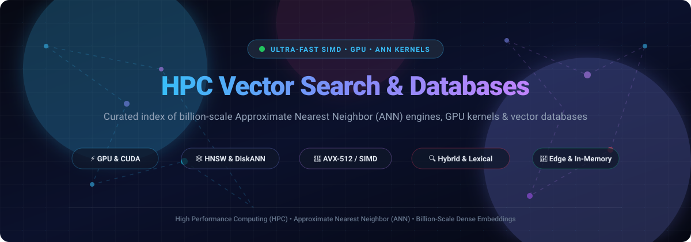

  

# ⚡ Awesome High-Performance Computing Vector Search 🚀

  <strong>A curated collection of billion-scale Approximate Nearest Neighbor (ANN) search engines, SIMD/GPU-accelerated vector databases, embedded vector retrieval kernels, and hybrid search platforms.</strong>

  🌟 Star if you find this useful! 🌟

---

## 📑 Table of Contents

- [📊 Sector Overview & Market Dynamics](#-sector-overview--market-dynamics)
- [☁️ SaaS / Hosted Platforms](#️-saas--hosted-platforms)
- [💻 Open-Source Equivalents & Tools](#-open-source-equivalents--tools)
  - [🌐 Distributed & Production Vector Databases](#-distributed--production-vector-databases)
  - [📦 Embedded, Edge & High-Performance Local Vector Engines](#-embedded-edge--high-performance-local-vector-engines)
  - [⚡ Core ANN Libraries & GPU-Accelerated Kernels](#-core-ann-libraries--gpu-accelerated-kernels)
  - [🔌 Database Extensions for Vector Search](#-database-extensions-for-vector-search)
  - [🔍 Multimodal & Hybrid Search Engines](#-multimodal--hybrid-search-engines)
- [📈 Star History](#-star-history)
- [🤝 Contributing](#-contributing)
- [💖 Support & Sponsorship](#-support--sponsorship)

---

## 📊 Sector Overview & Market Dynamics

The global vector search database market is estimated between **$1.7B and $2.5B**, growing at a compound annual growth rate (CAGR) of **~16%–24%** toward an estimated **$7B–$14B** by the early 2030s. The sector is **moderately fragmented among pure-play startups** (Pinecone, Qdrant, Weaviate, Milvus/Zilliz) competing on low-latency indexing, specialized hardware acceleration (SIMD/GPU), and hybrid retrieval, but exhibits **high concentration around hyperscalers and established database incumbents** (Postgres/pgvector, Elastic, DataStax/IBM, MongoDB, AWS, Google Cloud) treating vector retrieval as an integrated platform feature.

---

## ☁️ SaaS / Hosted Platforms

Commercial, fully managed, and cloud-hosted vector database services and enterprise hybrid search platforms, sorted by company size (market cap / valuation / revenue).

| Platform | Company Size (Valuation / Revenue) | Starting Pricing Tier | Free Tier / Trial Limits | Description |
| :--- | :--- | :--- | :--- | :--- |
| **[Elastic Cloud](https://elastic.co)** | 🏢 Public Market Cap (~$8B–$10B+); ARR >$1.2B | Standard hosted tier from **$95–$99/month** (or ~$0.13/hour) | **14-day free trial** with full platform capabilities (up to 8GB RAM and 240GB storage cluster) | Enterprise managed search platform offering dense vector search, HNSW indexing, and hybrid BM25 + semantic retrieval. |
| **[DataStax Astra DB](https://datastax.com)** | 🏢 Acquired by IBM in 2025 (last private valuation $1.6B; ~$247M ARR) | Pay-as-you-go starting at **$0.05/million read ops** + $0.25/GB storage | **Free forever plan** with $25/month recurring credits (~40GB storage, up to 5 serverless DBs; hibernates after 30 days inactivity) | Serverless, multi-cloud DBaaS built on Apache Cassandra with native JVector-powered high-performance vector search. |
| **[Pinecone](https://pinecone.io)** | 🦄 $750M valuation (Series B); ~$14M–$26M ARR | Starter tier is $0/mo; paid plans start at **Builder: $20/month flat** (or Standard: $50/month commitment) | **Free forever Starter plan**: 2GB storage (~300k vectors at 1536d), 5 serverless indexes, 2M write units/mo & 1M read units/mo on AWS us-east-1 | Proprietary, serverless cloud vector database engineered for low-latency, high-throughput similarity search at billion-vector scale. |
| **[Weaviate Cloud](https://weaviate.io)** | 🚀 ~$200M valuation (Series B); ~$12M ARR | Serverless Flex plan starting at **$45/month minimum commitment** | **Free forever tier**: 1 collection, up to 3 tenants, 100k objects, 1GB RAM, 10GB disk, 2k embed requests/day | Fully managed SaaS platform for Weaviate providing hybrid vector + keyword search, multi-tenancy, and built-in vectorization modules. |
| **[Zilliz Cloud (Milvus)](https://zilliz.com)** | 🚀 ~$113M total funding (Series B); ~$16M–$49M ARR | Serverless Pay-As-You-Go starting at **$0.41/Compute Unit-hour** (~$0.025/GB storage/mo) | **Free forever plan**: 5GB storage, up to 1M vectors (at 768d), max 2 collections | Enterprise managed cloud service built by the creators of Milvus featuring GPU-accelerated indexing (CAGRA) and tiered storage. |
| **[Qdrant Cloud](https://qdrant.io)** | 🚀 ~$88M total funding (Series B); ~$9M–$14M ARR | Standard managed tier starting around **$30–$60/month** (~$0.045/hour for 1 vCPU / 2GB RAM) | **Free forever single-node cluster**: 0.5 vCPU, 1GB RAM, 4GB disk (~1M vectors at 768d; auto-suspends after 1 week inactivity) | Managed cloud service for the Qdrant vector database offering automated scaling, backups, and distributed clustering. |
| **[Chroma Cloud](https://trychroma.com)** | 🚀 $75M valuation (Joined Replit in 2026); ~$20M funding | Starter is $0 base + usage ($2.50/GiB writes, $0.33/GiB-mo storage); Team plan starts at **$250/month** | **Free starter credits**: $5/month ongoing free credit allowance, storing up to ~1M embeddings across 10 databases | Hosted serverless offering of the AI-native Chroma embedding database for rapid RAG and LLM application deployment. |
| **[Marqo Cloud](https://marqo.ai)** | 🚀 $50M valuation (Series A); ~$1M–$5M ARR | Balanced compute cluster starting at **$0.06/hour** (~$43/month continuous runtime) | **Evaluation trial**: Free developer testing tier / onboarding credits; open-source container free forever | End-to-end managed tensor search platform combining inference and vector storage for multimodal text and image retrieval. |
| **[Vespa Cloud](https://vespa.ai)** | 🚀 ~$31M funding (Series A spun out of Yahoo); ~$6M–$11M ARR | Startup tier resource pricing starting at **$0.05/vCPU-hour**, $0.005/GB-RAM-hour, $0.0002/GB-disk-hour | **Free trial credits**: $300 in free initial cloud credits to test deployments; open-source engine free forever | Managed big data serving engine supporting real-time tensor computations, vector search, and lexical ranking at massive scale. |
| **[Deep Lake (Activeloop)](https://activeloop.ai)** | 🚀 ~$20M funding (Series A); ~$8M ARR | Managed cloud plans starting at **$40/user/month** (storage blocks at $99/100GB/month) | **Free developer plan**: 100MB managed cloud storage, trace & basic query allowance; open-source local SDK free forever | Managed cloud database for AI built specifically for storing, querying, and streaming multimodal tensors and embeddings. |

---

## 💻 Open-Source Equivalents & Tools

Free and open-source software (FOSS) vector databases, SIMD/GPU-accelerated ANN libraries, embedded search engines, and database extensions. Sorted by GitHub Stars_Count in descending order.

### 🌐 Distributed & Production Vector Databases

* **[Milvus](https://github.com/milvus-io/milvus)**  - Cloud-native, distributed open-source vector database designed for billion-scale similarity search with disaggregated storage and compute.
* **[Qdrant](https://github.com/qdrant/qdrant)**  - High-performance, open-source vector similarity search engine written in Rust featuring SIMD hardware acceleration, quantization, and rich payload filtering.
* **[Weaviate](https://github.com/weaviate/weaviate)**  - Open-source, AI-native vector database written in Go supporting HNSW indexing, hybrid BM25F + vector search, and GraphQL/REST APIs.
* **[OpenSearch](https://github.com/opensearch-project/OpenSearch)**  - Community-driven, open-source search and analytics suite supporting k-NN vector search backed by Faiss, NMSLIB, and Lucene.
* **[Vespa](https://github.com/vespa-engine/vespa)**  - Open-source, high-performance big data serving engine capable of low-latency ANN vector search, tensor evaluation, and machine-learned ranking.
* **[Vald](https://github.com/vdaas/vald)**  - Highly scalable, distributed open-source vector search engine built on the ultra-fast NGT algorithm and Kubernetes-native architecture.

### 📦 Embedded, Edge & High-Performance Local Vector Engines

* **[DuckDB VSS](https://github.com/duckdb/duckdb)**  - Open-source extension bringing HNSW-accelerated vector similarity search directly into the high-performance DuckDB analytical engine.
* **[Chroma](https://github.com/chroma-core/chroma)**  - Open-source AI-native embedding database designed for developer productivity with both in-memory/embedded and client-server modes.
* **[LanceDB](https://github.com/lancedb/lancedb)**  - Open-source, serverless vector database built on the columnar Lance data format offering zero-copy disk-based ANN search in Rust and Python.
* **[Orama](https://github.com/oramasearch/orama)**  - Fast, zero-dependency open-source full-text and vector search engine written in TypeScript for browsers, edge workers, and Node.js.
* **[sqlite-vec](https://github.com/asg017/sqlite-vec)**  - Extremely small, zero-dependency, pure-C vector search SQLite extension capable of running anywhere from servers to edge devices.
* **[Lance Format](https://github.com/lance-format/lance)**  - Modern columnar data format for AI and vector search implemented in Rust, optimized for fast random access and secondary indexing.

### ⚡ Core ANN Libraries & GPU-Accelerated Kernels

* **[Faiss (Facebook AI Similarity Search)](https://github.com/facebookresearch/faiss)**  - Industry-standard C++/CUDA library by Meta for efficient similarity search and clustering of dense vectors on CPU and multi-GPU clusters.
* **[ScaNN (Scalable Nearest Neighbors)](https://github.com/google-research/google-research)**  - Google Research's open-source library for efficient vector similarity search at scale using anisotropic vector quantization.
* **[Annoy (Approximate Nearest Neighbors Oh Yeah)](https://github.com/spotify/annoy)**  - Lightweight C++ library with Python bindings using random projection trees and memory-mapped files for shared-memory reads.
* **[Hnswlib](https://github.com/nmslib/hnswlib)**  - Header-only C++ library implementing Hierarchical Navigable Small World (HNSW) graphs, serving as the core engine behind numerous vector databases.
* **[USearch](https://github.com/unum-cloud/USearch)**  - Smaller, faster single-file C++11/Rust/Python HNSW vector search engine leveraging hardware SIMD instructions (AVX-512, NEON) and user-defined metrics.
* **[NMSLIB](https://github.com/nmslib/nmslib)**  - Non-Metric Space Library—efficient C++ library with Python bindings for approximate nearest neighbor search across arbitrary metrics.
* **[DiskANN](https://github.com/microsoft/DiskANN)**  - Microsoft Research's graph-based ANN library (Vamana) engineered for billion-scale vector search directly from NVMe SSDs with minimal RAM.
* **[Voyager](https://github.com/spotify/voyager)**  - Spotify's fast, low-memory open-source approximate nearest-neighbor search library written in C++ with Python and Java bindings.
* **[PySparNN](https://github.com/facebookresearch/pysparnn)**  - Meta's Python library for approximate nearest neighbor search on sparse, high-dimensional vector spaces.
* **[cuVS (NVIDIA RAPIDS)](https://github.com/rapidsai/cuvs)**  - Open-source GPU-accelerated vector search and clustering library featuring CAGRA, IVF-PQ, and brute-force CUDA primitives.

### 🔌 Database Extensions for Vector Search

* **[pgvector](https://github.com/pgvector/pgvector)**  - Open-source vector similarity search extension for PostgreSQL supporting exact and approximate nearest neighbor search (HNSW and IVFFlat).
* **[Redis Stack / RediSearch](https://github.com/RediSearch/RediSearch)**  - High-throughput in-memory search engine module supporting real-time HNSW and FLAT vector indexing alongside secondary filtering.
* **[Pgai / pgvectorscale](https://github.com/timescale/pgvectorscale)**  - Open-source PostgreSQL extension implementing DiskANN-inspired StreamingDiskANN indexes for high-performance, cost-efficient vector search.
* **[pgvecto.rs](https://github.com/tensorchord/pgvecto.rs)**  - High-performance Rust-based PostgreSQL vector extension supporting SIMD optimizations, binary quantization, and low-memory indexing.
* **[Apache Cassandra (JVector)](https://github.com/jbellis/jvector)**  - Pure-Java embedded vector search engine utilizing DiskANN-style graph algorithms and SIMD acceleration to power Cassandra 5.0.

### 🔍 Multimodal & Hybrid Search Engines

* **[Meilisearch](https://github.com/meilisearch/meilisearch)**  - Lightning-fast, open-source Rust search engine supporting hybrid semantic vector + typo-tolerant lexical search.
* **[Typesense](https://github.com/typesense/typesense)**  - Open-source, in-memory search engine written in C++ offering built-in vector search, auto-embeddings, and hybrid ranking.
* **[Deep Lake](https://github.com/activeloopai/deeplake)**  - Open-source dataset and tensor storage format enabling version-controlled multimodal embeddings and rapid streaming to PyTorch/TensorFlow.
* **[Marqo](https://github.com/marqo-ai/marqo)**  - Open-source tensor search engine integrating CLIP, OpenCLIP, and HuggingFace models directly into the indexing and query pipeline.

---

## 📈 Star History

---

## 🤝 Contributing

Contributions are warmly welcomed! 💖 Feel free to open a Pull Request to add more open-source vector databases, HPC ANN kernels, or SIMD/GPU-accelerated search engines.

1. 🍴 Fork the repository.
2. 🌿 Create your feature branch (`git checkout -b feature/cool-vector-engine`).
3. 📝 Add your project under the appropriate category with a concise description and correct links.
4. 🚀 Submit a Pull Request.

---

## 💖 Support & Sponsorship

Thank you for exploring this curated repository! If you find this project valuable for your AI, HPC, or similarity search research, please consider supporting its ongoing maintenance and curation:

- ⭐ **Star this repository** to help others discover it!
- 🍴 **Fork and share** it with your fellow engineers, data scientists, and AI builders.
- ☕ **Buy me a coffee**: Support the author directly via the [GitHub Sponsors Dashboard](https://github.com/sponsors/ishandutta2007). Your sponsorship helps keep this repository fresh, up-to-date, and comprehensive!
